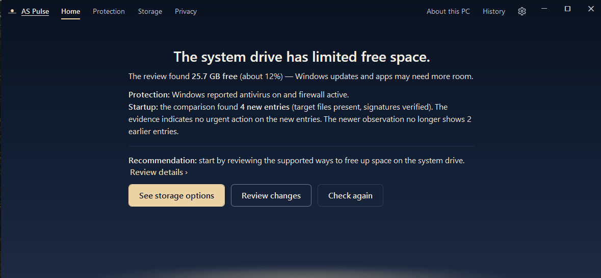
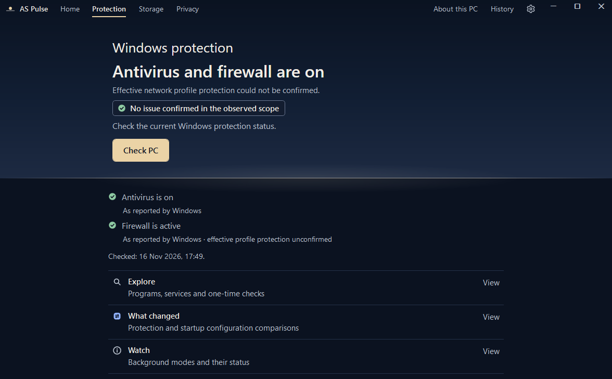
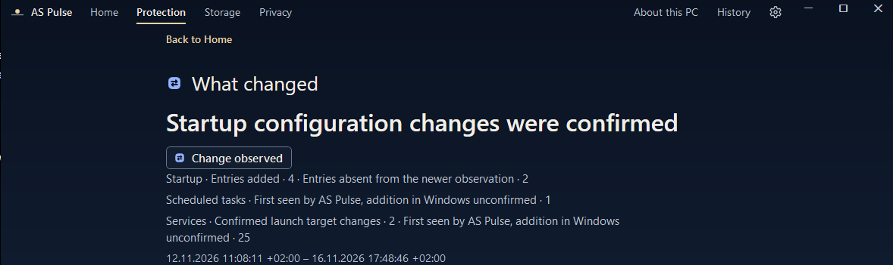
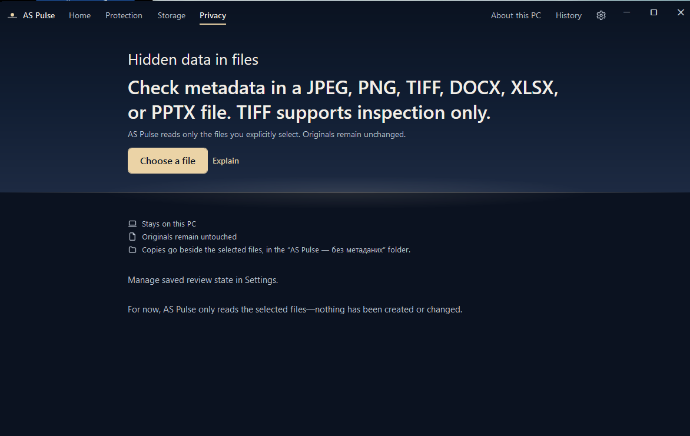

# AS Pulse

🇬🇧 [English](README.md) | 🇺🇦 [Українська](README.uk.md)

**Personal Windows Security & Change Companion**

**[🚀 Join the AS Pulse Closed Beta](https://aspulse.app)**  
*Free to participate. Access is by private invitation.*

This repository presents AS Pulse and contains project information. Application source code is maintained separately.

AS Pulse is a security-led, local-first Windows application that helps you review supported system information, understand changes and decide what to do next.

## Inside AS Pulse

These are screenshots of the running Windows application. The information shown is specific to the captured session; results and available actions can differ on your PC. Some screenshots are cropped to focus on the relevant interface.

### Home — a starting point for your PC

See a summary of supported observations and choose what to review next.

### Security — understand Windows protection

Review available protection information while keeping unconfirmed details clearly identified.

### Change Intelligence — understand what changed

Compare supported observations and examine a summary of confirmed configuration changes. Individual system entry names are omitted from this cropped preview.

### Privacy — user-selected files, local control

Inspect metadata in supported file formats. The app explains when originals remain unchanged and what actions are available.

## What AS Pulse helps you explore

- **Change Intelligence** helps you compare supported observations with saved results and see what has changed.
- **Security** presents available Windows protection information and explains its context and limits.
- **Watch** can monitor supported topics when enabled and permitted, and bring relevant changes to your attention.
- **Investigation** lets you examine supported startup, service and other system evidence in more detail.
- **Memory** can retain supported results locally when enabled. History and action receipts help you revisit earlier activity.
- **Privacy and safe system care** offer supported, user-directed actions. Review their scope before confirming them.
- **Recovery** provides a local Vault for files admitted by supported actions and can restore eligible files to their original location. Availability depends on the action and the file’s state.

AS Pulse operates locally for its core functions. You choose whether to create and share a support export. Website registration and support communications are separate from local application use.

## Limits

AS Pulse complements existing Windows protection. It is not an antivirus replacement or EDR. It does not guarantee threat detection or complete system protection. A finding depends on available Windows information, and some results may be incomplete or unknown. Review the scope of an action before confirming it. Not every cleanup action can be reversed, so keep your own backups.

## Closed Beta

AS Pulse Closed Beta is free and available by private invitation to selected testers. Version 1.0.2 targets Windows 11 Home or Pro, 64-bit, build 22631 or later. A 42-day Pro Preview can be started by the user, and Basic remains available after it ends.

**Interested in joining?** Visit [aspulse.app](https://aspulse.app) and submit a request through the available Closed Beta registration route. Selection and access are by private invitation.

For feedback or support, contact [support@aspulse.app](mailto:support@aspulse.app).
