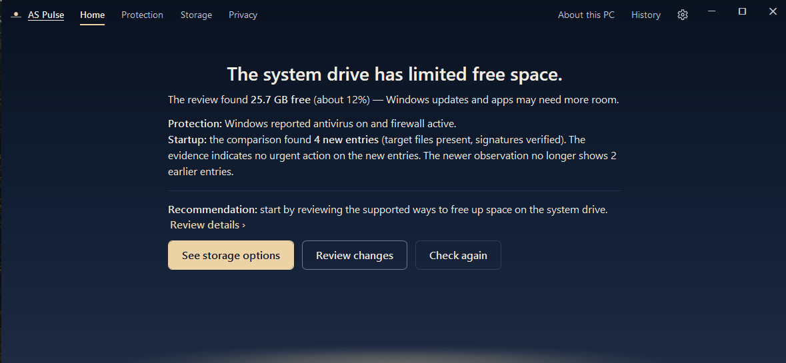
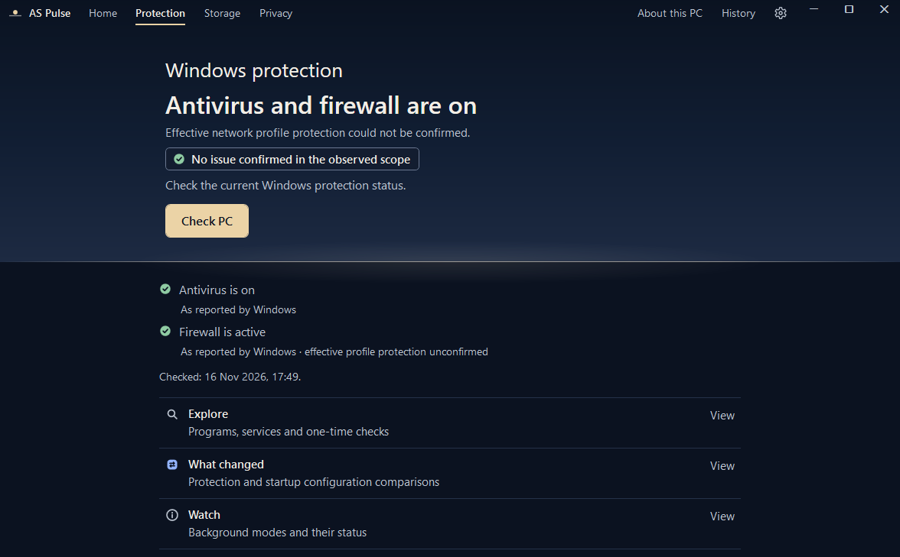
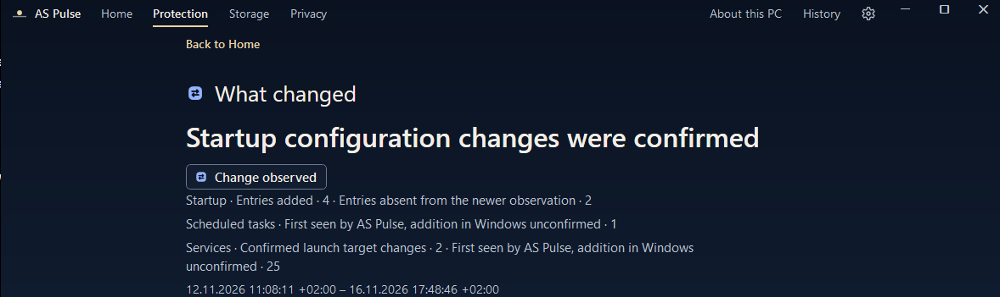
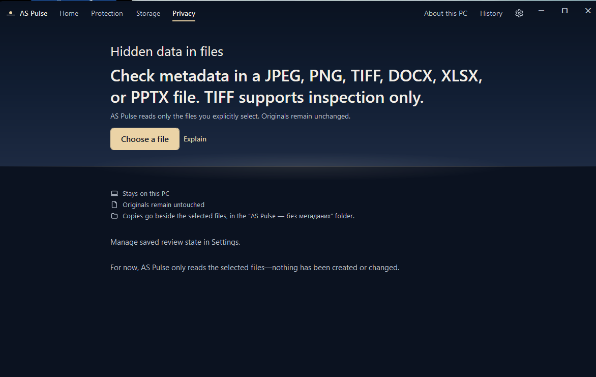

# AS Pulse

🇬🇧 [English](README.md) | 🇺🇦 [Українська](README.uk.md)

**Персональний помічник із безпеки Windows та контролю змін**

**[🚀 Приєднатися до закритого тестування AS Pulse](https://aspulse.app)**  
*Участь безкоштовна. Доступ надається за персональним запрошенням.*

Цей репозиторій призначений для представлення AS Pulse та інформації про проєкт. Вихідний код застосунку зберігається окремо.

AS Pulse — застосунок для Windows, що працює переважно локально й зосереджується на безпеці. Він допомагає переглядати доступну інформацію про систему, розуміти зміни та вирішувати, що робити далі.

## Як виглядає AS Pulse

Це знімки екрана працюючого застосунку Windows. Показані відомості стосуються конкретного сеансу; результати та доступні дії на вашому комп’ютері можуть відрізнятися. Частину знімків обрізано, щоб зосередити увагу на відповідному екрані.

### Головний екран — із чого почати

Переглядайте підсумок підтримуваних спостережень і вибирайте, що перевірити далі.

### Безпека — розумійте стан захисту Windows

Переглядайте доступну інформацію про захист, не плутаючи підтверджені та непідтверджені відомості.

### Change Intelligence — дізнавайтеся про зміни

Порівнюйте підтримувані спостереження та переглядайте підсумок підтверджених змін конфігурації. Назви окремих системних записів не включено до обрізаного знімка.

### Приватність — обрані вами файли й локальний контроль

Досліджуйте метадані підтримуваних форматів. Застосунок пояснює, коли оригінали залишаються незмінними та які дії доступні.

## Що допомагає досліджувати AS Pulse

- **Change Intelligence («Зміни»)** допомагає порівнювати підтримувані спостереження зі збереженими результатами та бачити, що змінилося.
- **Security («Безпека»)** показує доступну інформацію про захист Windows і пояснює її значення та обмеження.
- **Watch («Спостереження»)** може відстежувати підтримувані стани, коли спостереження ввімкнене й дозволене користувачем, і звертати увагу на важливі зміни.
- **Investigation («Дослідження»)** дає змогу детальніше вивчати підтримувані відомості про автозапуск, служби та інші компоненти системи.
- **Memory («Пам’ять»)** може локально зберігати підтримувані результати, коли цю можливість увімкнено. Історія та квитанції дій допомагають повертатися до попередніх подій.
- **Privacy and safe system care («Приватність і догляд»)** пропонує підтримувані дії, які користувач запускає за власним рішенням. Перед підтвердженням ознайомтеся з їхніми межами.
- **Recovery («Відновлення»)** надає локальне сховище Vault для файлів, збережених у межах підтримуваних дій, і може повертати придатні до відновлення файли до їхнього початкового розташування. Можливість відновлення залежить від конкретної дії та стану файлу.

Основні функції AS Pulse працюють локально. Ви самі вирішуєте, чи створювати й передавати експорт даних для підтримки. Реєстрація на сайті та листування зі службою підтримки відокремлені від локального використання програми.

## Обмеження

AS Pulse доповнює наявні засоби захисту Windows, але не замінює антивірус чи EDR. Програма не гарантує виявлення загроз або повного захисту системи. Висновки залежать від доступних відомостей Windows; деякі результати можуть бути неповними або залишатися невідомими. Перш ніж підтверджувати дію, перевіряйте, на що саме вона впливає. Не всі дії з очищення можна скасувати, тому зберігайте власні резервні копії.

## Закрите бета-тестування

Участь у Closed Beta AS Pulse безкоштовна й доступна обраним тестувальникам за персональним запрошенням. Версія 1.0.2 призначена для **Windows 11 Home або Pro, 64-бітної версії, збірки 22631 чи новішої**. Користувач може самостійно запустити **42-денний Pro Preview**; після його завершення залишається доступним режим **Basic**.

**Хочете взяти участь?** Перейдіть на [aspulse.app](https://aspulse.app) і подайте заявку через доступну форму реєстрації на закрите бета-тестування. Відбір і надання доступу відбуваються за персональним запрошенням.

Для відгуків або звернень до підтримки: [support@aspulse.app](mailto:support@aspulse.app).
